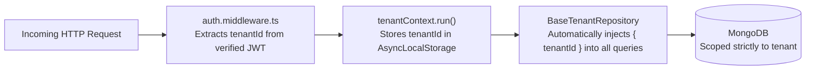
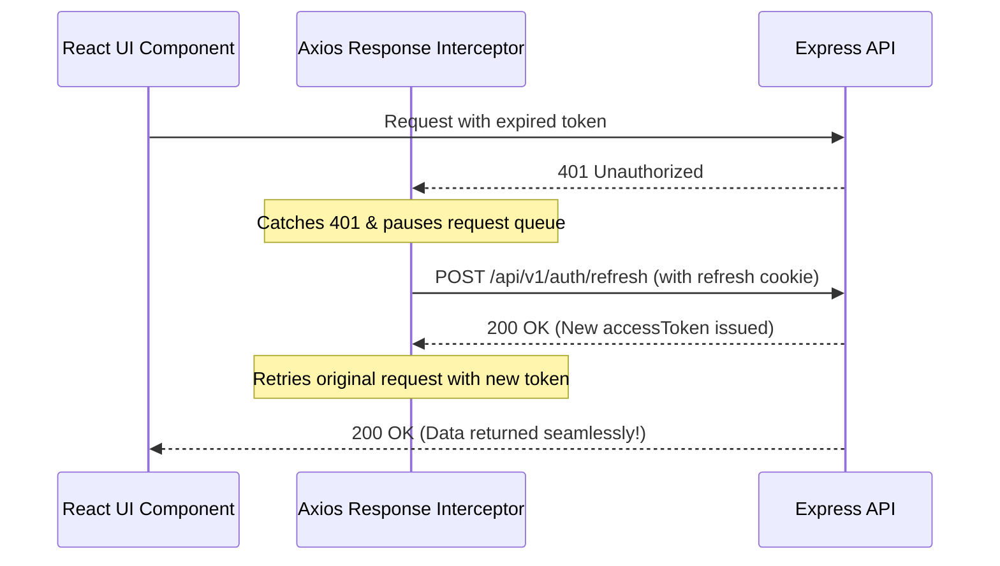

# 03. Architecture & How It Works

This document explains the core architectural mechanisms powering the Triune Engineering Standard.

---

## 1. Multi-Tenancy Data Isolation

We never trust client-supplied tenant IDs. Data isolation is enforced at the repository layer using Node.js `AsyncLocalStorage`:



- When a query executes, `this.getTenantId()` is pulled directly from the current request thread.
- Even if a user alters request parameters, they can never query or mutate another tenant's records.

---

## 2. Dual Authentication & Silent Token Refresh

The application supports both browser web apps and mobile/desktop clients:

1. **Web Browsers**: Stores tokens in secure cookies (`accessToken` for 15 minutes, `refreshToken` for 7 days).
2. **Mobile / API Clients**: Sends tokens via standard `Authorization: Bearer <token>` header.

### Silent Refresh Interceptor Flow:
When an access token expires (15 minutes), the browser interceptor automatically handles renewal without interrupting the user:



---

## 3. Role-Based Access Control (RBAC)

Authorization is managed via clean role checks using `requireRole`:

```typescript
router.post(
  '/',
  requireRole('TENANT_ADMIN', 'STAFF'),
  validate({ body: createStudentSchema }),
  (req, res, next) => controller.create(req, res, next)
);
```

- **SUPER_ADMIN**: Global system administrator with bypass access to all tenants and routes.
- **TENANT_ADMIN**: Complete management of the specific school/tenant.
- **STAFF**: Operational permissions (read, create, update).
- **USER**: Standard end-user with basic read-only access.

---

## 4. Multi-Collection ACID Transactions

When performing operations across multiple collections (e.g. Student admission + Invoice creation), we use the `withTransaction` unit of work helper:

```typescript
import { withTransaction } from '../../core/database/transaction.js';

await withTransaction(async (session) => {
  await studentRepo.create(studentData, { session });
  await invoiceRepo.create(invoiceData, { session });
  // If anything throws, all changes automatically roll back!
});
```

> **Smart Standalone Fallback:** If running on a standalone local MongoDB without a replica set, `withTransaction` automatically falls back to non-transactional execution so development does not crash.

---

## 5. Two-Tier Rate Limiting

Configured directly in `server/.env`:

1. **Global Rate Limiter**: 100 requests per 15 minutes per IP applied across `/api/*`. Protects against scraping and DDoS.
2. **Auth Rate Limiter**: 5 attempts per 15 minutes per IP on `/api/v1/auth/login` and `/register`. Blocks brute-force password guessing.
- Exceeding limits triggers HTTP `429 Too Many Requests` with `Retry-After` header.

---

## 6. Centralized Error Logging

- **Client Challenges (4xx)**: Logged cleanly as `logger.warn` without printing full stack traces to the terminal.
- **Server Crashes (5xx)**: Logged as `logger.error` with correlation IDs and full stack traces written to `server/logs/error.log`.
